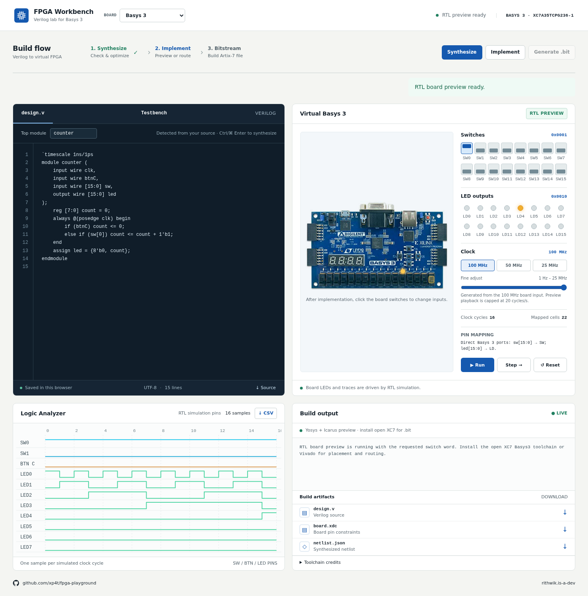

# FPGA Workbench



A browser workbench for editing Verilog, synthesizing it, choosing virtual switch inputs, viewing LEDs and waveforms, and generating an Artix-7 `.bit` with the open XC7 toolchain or Vivado. Select Basys 3, Nexys A7 100T, or Arty A7 100T in the header. The Basys 3 fabric model is included here and comes from [virtual-basys3](https://github.com/xp4t/virtual-basys3).

## Run locally

On Linux, install `yosys`, `iverilog`, `vvp`, Bubblewrap (`bwrap`), and `prlimit`
(from `util-linux`) on your path. Use Python 3.11 or newer.
Unprivileged user namespaces must be available; builds fail closed if the sandbox
cannot start. Create a local Python environment:

```sh
python3 -m venv .venv
.venv/bin/python -m pip install -r requirements.txt
```

Then run:

```sh
.venv/bin/python server.py
```

The core server supports Python 3.11 and newer and needs no pip packages. Optional
bitstream decoding has a separate environment; see [decoder setup](docs/DEPLOY.md#optional-bitstream-decoder).

Open <http://127.0.0.1:8000>. The default counter is ready to edit. **Synthesize** runs Yosys. **Implement** asks for a switch word sized to the selected board, starts an Icarus Verilog RTL simulation for the board and waveform, then places and routes the design when an Artix-7 backend is installed. The virtual board can then be stepped, run, and controlled with switches and pushbuttons. The switch word sets simulated input pins; it is not baked into the bitstream. Changing boards clears the current build artifacts but keeps the editor source.

The local preview records up to 4096 clock cycles per implementation. Choose **Implement** again to restart the capture with a new switch word. The waveform panel can export its samples as CSV.

The board clock input is 100 MHz. The **Clock** control offers 100, 50, and 25 MHz presets and a logarithmic slider from 25 MHz down to 1 Hz. For a design with a `clk` input, lower settings synthesize a counter divider into the bitstream. Some slider values round to the nearest rate achievable by an integer divider; the interface shows that actual rate. Changing the clock requires **Synthesize**, **Implement**, and **Generate .bit** again. The RTL preview advances one selected clock edge per sample; browser playback runs at the selected rate up to 20 cycles per second, rather than trying to animate millions of cycles per second. A design without `clk` has no clock to divide.

## Hosting and resource limits

The editor is static and stays available when the build server is offline. It keeps
Verilog and testbench drafts in browser storage and lets you download your source.
Build controls reconnect automatically when the backend returns.

Synthesis, implementation, bitstream generation, and custom testbenches return
**HTTP 202 with a job ID**. One worker runs the queued build; the browser polls its
private job for state, elapsed time, queue position, and tool output. Reloading a
page resumes an active job. Sessions and jobs are temporary and reset on backend
restart; jobs are retained for one hour after completion.

Public API traffic passes through a Vercel function that injects a private
`X-Backend-Secret` header. The Python backend rejects missing or incorrect secrets,
even with a forged browser Origin. Defaults allow one active job per workspace,
four waiting builds, and six build submissions per minute per IP. Tool processes
inherit memory, CPU, and file-size limits; wall-time and workspace checks terminate
the process group. The provided systemd service adds aggregate CPU/RAM/task limits
and a bounded ephemeral filesystem for all sessions.

See [docs/DEPLOY.md](docs/DEPLOY.md) for Vercel environment variables, a named
Cloudflare tunnel, service configuration, quota tuning, Render RTL hosting, and
migration from the retired Quick Tunnel/cron workflow. No Vercel credentials are
needed on the build machine.

For `fpgaplayground.com` with AWS EC2 running the tools, use the self-contained
[fpgapg-ws deployment folder and complete setup guide](fpgapg-ws/README.md).

## Custom testbenches

Open the **Testbench** tab, paste an Icarus-compatible Verilog/SystemVerilog
bench, and choose its top module (default `tb`). **Run testbench** compiles the
current editor source together with your bench, independently of the board build.
Use `$finish` to end simulation and `$dumpfile("testbench.vcd")` with `$dumpvars`
for a downloadable VCD. Simulator output appears in Build output; `user_design.v`,
`testbench.v`, and `testbench.vcd` appear in Artifacts. Simulation has a 30-second
limit and shares the build queue, sandbox, and quotas.

## Generate a board bitstream

On Linux x86-64, install the [open XC7 toolchain](https://github.com/FPGAwars/tools-openxc7) and matching databases for both FPGA parts with:

```sh
./scripts/install_openxc7.sh
```

The installer writes to `.tools/openxc7`, which is excluded from version control. You can also set `OPENXC7_DIR` to an installed open XC7 package root. It needs `bin/nextpnr-xilinx`, `bin/fasm2frames`, `bin/xc7frames2bit`, chip databases for `xc7a35tcpg236` and `xc7a100tcsg324`, and the matching Project X-Ray part files. The [FPGAwars release assets](https://github.com/FPGAwars/tools-openxc7/releases) provide the tool package and both chip database archives. Keep their release tags together; a chip database built against a different nextpnr revision can fail at runtime.

With open XC7 installed, **Synthesize** maps the board design with Yosys `synth_xilinx`. **Implement** invokes `nextpnr-xilinx` to produce `routed.json` and `design.fasm`. **Generate .bit** uses `fasm2frames` and `xc7frames2bit` to produce the downloadable `design.bit`. The build artifacts include each intermediate file so you can inspect the actual output of every stage. Without an Artix-7 backend, Implement runs the RTL preview and the interface reports that bitstream generation is unavailable.

Alternatively, install Vivado with support for `xc7a35tcpg236-1` and `xc7a100tcsg324-1` and put `vivado` on `PATH`, or set `VIVADO_BIN` to its executable. Vivado takes precedence when both backends are installed. The Basys 3 bitstream decoder uses the Python packages in `requirements-decoder.txt` and the Artix-7 Project X-Ray database shipped with the open XC7 toolchain. If you use Vivado without installing open XC7, set `PRJXRAY_DB_ROOT` to a compatible Artix-7 database directory containing `xc7a35tcpg236-1/part.json` and `package_pins.csv`.

The decoder now selects the board's FPGA part, package-pin database, generated
XDC, switch/LED widths, and button mapping. Basys 3, Nexys A7 100T, and Arty A7 100T
can use the reconstructed fabric at 100 MHz when the optional dependencies and a
prebuilt connection database for their part are installed. Decoder conversion
runs inside the same sandbox and resource limits as the build. Unsupported
primitives or incomplete database coverage retain the RTL preview and report an
error; this remains a limited fabric simulator. Divided clocks use RTL playback
because advancing millions of source clock edges is impractical.

### Open source tool authors

- [Yosys](https://github.com/YosysHQ/yosys), created by Claire Wolf and maintained with YosysHQ contributors, synthesizes the Verilog.
- [Icarus Verilog](https://github.com/steveicarus/iverilog), by Stephen Williams and contributors, runs the virtual board and waveform simulation.
- [nextpnr-xilinx](https://github.com/openXC7/nextpnr-xilinx), originating with David Shah's nextpnr Xilinx work and extended by openXC7 contributors, places and routes the design.
- [FASM](https://github.com/chipsalliance/fasm), designed by F4PGA project developers, is the readable feature format between routing and bitstream encoding.
- [Project X-Ray](https://github.com/f4pga/prjxray) and its [7-series database](https://github.com/f4pga/prjxray-db), by the Project X-Ray contributors including Antmicro, Google LLC, Claire Wolf, Rick Altherr, Jake Mercer, and David Shah, document and encode the Artix-7 configuration frames.
- The [FPGAwars open XC7 package](https://github.com/FPGAwars/tools-openxc7) was started by Juan González-Gómez, with cross-platform packaging and toolchain contributions by Carlos Venegas. It assembles these tools for the supported Artix-7 parts.

## Tests and license

```sh
python3 -m unittest discover -s tests -v
node --test tests/*.cjs
```

Use Node 22 or newer. GitHub Actions runs both suites on Linux with Python 3.11,
Yosys, Icarus, and Bubblewrap, and checks the optional decoder installation.
Tool integration tests skip when isolation or tools are unavailable; CI first
checks the sandbox so those RTL checks cannot silently skip.

[MIT license](LICENSE). Copied board constraints retain the
[Digilent license](boards/Digilent-License.txt); external tools and databases keep
their upstream licenses.

## Top module and board pins

When the source declares one module, the workbench detects its name automatically. With multiple modules, set **Top module** to the module you want to build.

Small modules with arbitrary port names map input bits to switches and output bits to LEDs in declaration order. For example, `module ha(input a, b, output sum, carry)` maps `a`/`b` to `SW0`/`SW1` and `sum`/`carry` to `LD0`/`LD1`. The mapping appears beside the board and in the Implement dialog. Ports named `clk` and supported button names use the board clock or buttons instead of switches.

| Board | FPGA part | Switches / LEDs | Buttons | Pin source |
| --- | --- | --- | --- | --- |
| Basys 3 | `xc7a35tcpg236-1` | 16 / 16 | `btnC`, `btnU`, `btnD`, `btnL`, `btnR` | [Basys 3 master XDC](boards/Basys-3-Master.xdc) |
| Nexys A7 **100T** | `xc7a100tcsg324-1` | 16 / 16 | Same five names | [Digilent Nexys A7 100T XDC](https://github.com/Digilent/digilent-xdc/blob/master/Nexys-A7-100T-Master.xdc) |
| Arty A7 **100T** | `xc7a100tcsg324-1` | 4 / 4 | `btnC`→BTN0, `btnU`→BTN1, `btnD`→BTN2, `btnL`→BTN3; or native `btn[3:0]` | [Digilent Arty A7 100 XDC](https://github.com/Digilent/digilent-xdc/blob/master/Arty-A7-100-Master.xdc) |

Modules with full size `sw` and `led` ports connect directly to the selected board. On Arty A7, a 16-bit Basys-style `sw`/`led` design can still build: only the low four switch and LED bits connect; `sw[15:4]` is tied low and `led[15:4]` is not connected. The mapping summary states this. Basys 3 also supports `seg[6:0]`, `dp`, and `an[3:0]`; Nexys A7 supports `seg[6:0]`, `dp`, and `an[7:0]`. Arty A7 has no seven-segment display. The copied Digilent XDC files are under the [Digilent MIT license](boards/Digilent-License.txt).
